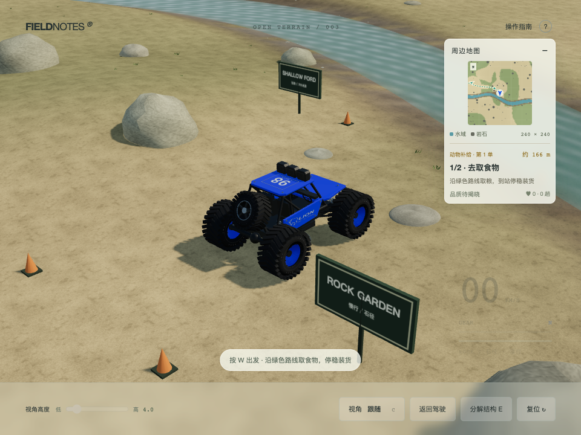

# Toy2Trail · 玩具越野记

**把现实中的玩具车，变成可以驾驶的山野冒险。**

Turn a real toy car into a playable Three.js off-road adventure.

基于两张玩具越野车照片，以 Three.js 程序建模还原蓝色遥控车。开过石径、河流和山脊，沿地图取粮，把食物送给山顶的小动物。



## 开始玩

下载 [独立网页 `blue-98.html`](dist/blue-98.html)，保存后用现代浏览器打开即可。

- 无需安装 Node.js 或启动服务器。
- 网页已内嵌 Three.js、界面、模型和程序贴图，可离线运行。
- 浏览器需支持 WebGL 2；手机提供触屏操作。

`BLUE / 98` 是游戏中蓝色玩具车的型号。

## 玩法

- **自由越野**：地形随驾驶延伸，没有场地围栏；可探索石径、浅滩、泥地和山脊。
- **登山与攀石**：四轮贴合地形，中低岩石可攀过；车身有悬挂回弹，上坡减速，下坡会滑行。
- **动物伙伴**：到达山顶营地，遇见小兔、狐狸和熊猫。
- **食物配送**：沿绿色路线到随机取货点，停稳装上车顶食物箱，再沿金色路线送到营地。
- **随机品质**：普通、优质、珍品食物分别奖励 10、20、35 颗爱心；完成后可接下一单。
- **本地存档**：收藏、订单、货物和爱心保存在当前浏览器，复位与刷新可保留。
- **模型检视**：可以环绕查看、点击零件，并展开车轮、外壳、防滚架与悬挂结构。

## 操作

| 操作 | 按键 |
| --- | --- |
| 前进 / 倒车 | W / S，或 ↑ / ↓ |
| 左转 / 右转 | A / D，或 ← / → |
| 刹车 / 坡道驻车 | 按住空格，或触屏刹车 |
| 回到起点 | R |
| 切换跟随、侧跟、俯视 | C |
| 调整视角高度 | 底部滑杆 |
| 环绕 / 缩放 / 选择零件 | 检视模式中拖动 / 滚轮 / 点击 |
| 分解 / 还原模型 | 检视模式中按 E |

在取货圈内停稳约 **1.6 秒**自动装货，在营地停稳约 **1.8 秒**自动卸货。**坡道装卸时请持续按住刹车**。切换窗口会停车，再次输入驾驶按键后恢复。

## 本地开发

需要 Node.js 20 或更高版本。

```sh
git clone https://github.com/yuhaiyang012/toy2trail.git
cd toy2trail
npm ci
npm run dev
```

打开 [http://127.0.0.1:5198/](http://127.0.0.1:5198/)。

```sh
npm run check                  # TypeScript 检查
npm test                       # 11 组逻辑、几何和驾驶测试
npm run build                  # 构建网站及自包含 HTML
node scripts/artifact.test.mjs  # 检查独立网页资源完整性
```

构建产物：

- `dist/blue-98.html`：可直接打开的单文件游戏。
- `dist/index.html` 与 `dist/assets/`：用于静态托管的标准构建输出。

## 浏览器检查

测试使用 `playwright-core`，默认调用 macOS 上已安装的 Google Chrome。其他位置可设置 `RC_CHROME` 为浏览器可执行文件路径。

```sh
npm run build
node scripts/realism.visual.mjs
node scripts/delivery.browser.test.mjs
```

macOS 可加 `RC_ANGLE=metal` 使用硬件渲染；默认使用软件 WebGL。报告与截图写入 `evidence/`。建议串行执行浏览器测试。

开发页面加 `?terrain-review=1` 可显示场景检查入口；正常游戏隐藏这些控件。`?review=1` 用于棚拍式模型检视。

## 主要模块

| 文件 | 职责 |
| --- | --- |
| `src/model.ts`、`src/vehicle-spec.json` | 程序车模与尺寸参数 |
| `src/physics.ts`、`src/collision.ts`、`src/suspension.ts` | 驾驶、碰撞与轮胎接触 |
| `src/bodyMotion.ts` | 车身悬挂回弹 |
| `src/terrain.ts`、`src/ridge.ts`、`src/world.ts` | 地形、山脊与地块生成 |
| `src/surfaceMaterials.ts`、`src/outdoorLighting.ts` | 程序材质、天空与光照 |
| `src/drivingEffects.ts` | 尘土、水花与轮迹 |
| `src/minimap.ts`、`src/navigation.ts` | 地图与相机 |
| `src/destination.ts`、`src/animalCamp.ts` | 动物营地与收藏 |
| `src/delivery.ts`、`src/deliveryScene.ts` | 随机配送与可见货物 |

## 模型说明

车辆由照片近似重建，所有网格与贴图由程序生成，没有外部模型或 CDN 依赖。比例、背面结构和机械细节并非实物精密测量，未通过照片逐像素匹配认证。

驾驶使用简化运动学和轮胎接触采样，不模拟完整刚体、腾空、翻车、轮胎变形或载重变化。“无边界”通过有限数量地块的加载与回收实现。

Three.js 的 MIT 许可证保留在独立 HTML 与 [第三方许可说明](THIRD_PARTY_NOTICES.md) 中。
